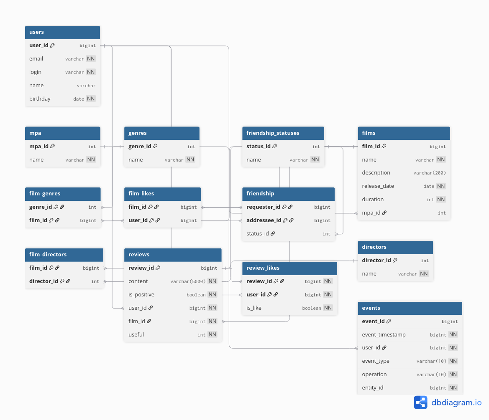

# Filmorate

REST API каталога фильмов с пользователями, лайками, отзывами и рекомендациями. Приложение позволяет хранить сведения о фильмах, искать их и выбирать популярные.

Учебный проект в рамках курса Java-разработки Яндекс Практикума.

## Возможности

- Создание, изменение, получение и удаление фильмов и пользователей.
- Лайки и подбор популярных фильмов с фильтрацией по жанру и году.
- Поиск фильмов по названию, режиссёру и описанию.
- Работа с жанрами, возрастными рейтингами и режиссёрами.
- Друзья, общие друзья и общие понравившиеся фильмы.
- Рекомендации и лента событий пользователя.
- Отзывы о фильмах и оценки полезности отзывов.
- Проверка входных данных и обработка ошибок API.

## Технологии

Java 21 · Spring Boot · Spring MVC · Bean Validation · JdbcTemplate · SQL · H2 · Lombok · Maven · JUnit 5 · AssertJ

## Устройство проекта

- `controller` — HTTP-запросы и ответы.
- `service` — правила работы с фильмами, пользователями и связанными сущностями.
- `storage` — интерфейсы хранилищ и реализации, включая SQL-запросы через JdbcTemplate.
- `model` — модели данных.
- `exception` — исключения и обработка ошибок.

## Запуск

Нужны JDK 21 и Maven.

```bash
git clone https://github.com/plisha39-dotcom/java-filmorate.git
cd java-filmorate
mvn spring-boot:run
```

При стандартных настройках API доступно по адресу `http://localhost:8080`.

Настройки находятся в [application.properties](src/main/resources/application.properties). Используется файловая H2 по адресу `jdbc:h2:file:./db/filmorate`; отдельный сервер базы данных не нужен.

При запуске выполняются [schema.sql](src/main/resources/schema.sql) и [data.sql](src/main/resources/data.sql).

## Пример использования

Создать фильм:

```bash
curl -X POST http://localhost:8080/films \
  -H 'Content-Type: application/json' \
  -d '{
    "name": "Интерстеллар",
    "description": "Путешествие за пределы Солнечной системы",
    "releaseDate": "2014-11-06",
    "duration": 169,
    "mpa": {"id": 3}
  }'
```

Получить каталог и популярные фильмы:

```bash
curl http://localhost:8080/films
curl 'http://localhost:8080/films/popular?count=10'
```

## Основные маршруты

| Метод | Путь | Действие |
| --- | --- | --- |
| GET / POST / PUT | `/films` | Получить каталог, создать или изменить фильм |
| GET / DELETE | `/films/{id}` | Получить или удалить фильм |
| PUT / DELETE | `/films/{id}/like/{userId}` | Добавить или убрать лайк |
| GET | `/films/popular` | Получить популярные фильмы |
| GET | `/films/search?query=...&by=title` | Найти фильмы |
| GET / POST / PUT | `/users` | Получить пользователей, создать или изменить пользователя |
| GET | `/users/{id}/recommendations` | Получить рекомендации |
| GET | `/users/{id}/feed` | Получить ленту событий |

Полный набор маршрутов описан в [контроллерах](src/main/java/ru/yandex/practicum/filmorate/controller).

## Схема базы данных



Актуальные определения таблиц и связей находятся в [schema.sql](src/main/resources/schema.sql).

## Тестирование

```bash
mvn test
```

В проекте есть тесты контроллеров, сервисов, валидации моделей и хранилищ. Проверяются операции с данными, поиск, лайки, связи между сущностями и ошибочные ситуации.

## Учебный фокус

Разделение HTTP-обработки, бизнес-логики и хранения данных; проектирование реляционной схемы; SQL-запросы и преобразование результатов через RowMapper; автоматизированная проверка поведения приложения.
